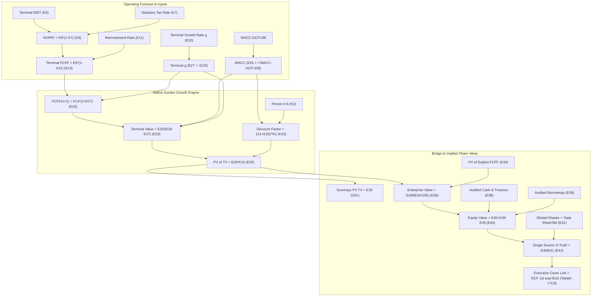

# Human Review & Approval Packet: 17-Sheet Master Template Excel Models (Template V5)

> [!IMPORTANT]
> **HISTORICAL VALUATION SNAPSHOT NOTICE**: All financial models, closing stock prices, market capitalizations, Treasury yields, peer trading multiples, and empirical regression datasets in this release reflect historical market observations as of **Wednesday, October 15, 2025 (`2025-10-15`)**. They are **NOT** current or live market valuations and do not incorporate subsequent market events.
>
> **APPROVAL GATE STATUS**: In strict adherence to repository safety invariants (`DISALLOWED_REVIEWER_TOKENS` prohibiting agent self-promotion), the **`human_pack_approval` gate remains PENDING (`ready: false`)**. These models are delivered in proposal/validation state pending explicit sign-off by the human reviewer. PR #3 remains open and unmerged.

---

## 1. Governance & Pull Request Information

- **Branch**: `agent/argon-continue`
- **Pull Request**: [Pull Request #3: Complete Four Priority Targets Excel Release](https://github.com/keshavmittal2203-droid/excel-model-maker/pull/3)
- **Repository Root**: `C:/Users/kesha/Documents/Codex/2026-10-16/https-x-com-painn-x-status/outputs/excel-model-maker`
- **Latest Commit**: `57ba82a`
- **Scope**: Strictly Excel financial research workbooks (`template_v5`), native sheet previews, and formula-linkage validation. Zero PowerPoint decks or presentation assets modified in this branch.
- **Master Template**: Byte-for-byte cloned from immutable master `originals/Marksans Keshav.xlsx` (SHA-256: `5a1f9af7d1be9f5a68c9be5927017f3be6fd421399b6951a5b9c17d6455b462a`). Verified unchanged before and after build.

---

## 2. Deliverable Verification Matrix (Template V5)

All four priority targets have been delivered as uncompressed 17-sheet master template workbooks under `companies/<TARGET>/template_v5/`. Prior versions (`template_v4`, `template_v3`, `template_v2`, and 6-sheet workbooks) are preserved intact in their respective directories.

| Target Company | Primary Valuation Methodology | Source-of-Truth Cell (`'DCF 1st way'`) | Cover Link Cell (`'Model ->'`) | Implied Value per Share | 15-Oct-2025 Market Close | Linked WACC (`E26`) | Formula Errors (68 Sheets) | Verified Workbook SHA-256 Checksum |
| :--- | :--- | :---: | :---: | :---: | :---: | :---: | :---: | :---: |
| **Mahindra & Mahindra Limited** (`MM`) | Sum-of-the-Parts (SOTP) Valuation | `E42` (`=G60`) | `C9` (`=E42`) | **₹2,742.97** | ₹3,497.20 | N/A (SOTP) | **0 errors** | `1e9e13b934b24eeb7d5ccd1419b6b3d873d18dd088c01b01c4d0d73386b3de8a` |
| **LTIMindtree Limited** (`LTM`) | Full-Year Annual FCFF DCF Baseline | `E42` (`=E40/E41`) | `C9` (`=E42`) | **₹2,811.09** | ₹5,609.50 | **11.87%** | **0 errors** | `214592ce3e00eb1467d9e2b4f00b37382a0279f0e914eed9b68e136c851ebe3e` |
| **Clean Science and Technology** (`CLEAN`) | Manufacturing FCFF DCF Baseline | `E42` (`=E40/E41`) | `C9` (`=E42`) | **₹480.89** | ₹1,041.40 | **11.73%** | **0 errors** | `da851ea3530c94609b4b25a0f254e8028a51a2e2903b078b65bd06afa3876650` |
| **Edelweiss Financial Services** (`EDELWEISS`) | Financial Services SOTP (Industrial FCFF N/A) | `E42` (`=G60`) | `C9` (`=E42`) | **₹130.53** | ₹108.85 | N/A (SOTP) | **0 errors** | `2763fdc29b3b972930176fcbed3edad4b2cbb0ab32fc9a7d03bf08ce9ebe0660` |

### Clickable Absolute Deliverable Paths

1. **Mahindra & Mahindra Limited (`MM`)**:
   - 17-Sheet Workbook: [`companies/MM/template_v5/MM-FullTemplate.xlsx`](file:///C:/Users/kesha/Documents/Codex/2026-10-16/https-x-com-painn-x-status/outputs/excel-model-maker/companies/MM/template_v5/MM-FullTemplate.xlsx) (128,596 bytes)
   - Package Manifest: [`companies/MM/template_v5/package.manifest.json`](file:///C:/Users/kesha/Documents/Codex/2026-10-16/https-x-com-painn-x-status/outputs/excel-model-maker/companies/MM/template_v5/package.manifest.json)
   - Sheet Previews (17 PDFs): [`companies/MM/template_v5/previews/`](file:///C:/Users/kesha/Documents/Codex/2026-10-16/https-x-com-painn-x-status/outputs/excel-model-maker/companies/MM/template_v5/previews/)

2. **LTIMindtree Limited (`LTM`)**:
   - 17-Sheet Workbook: [`companies/LTM/template_v5/LTM-FullTemplate.xlsx`](file:///C:/Users/kesha/Documents/Codex/2026-10-16/https-x-com-painn-x-status/outputs/excel-model-maker/companies/LTM/template_v5/LTM-FullTemplate.xlsx) (128,830 bytes)
   - Package Manifest: [`companies/LTM/template_v5/package.manifest.json`](file:///C:/Users/kesha/Documents/Codex/2026-10-16/https-x-com-painn-x-status/outputs/excel-model-maker/companies/LTM/template_v5/package.manifest.json)
   - Sheet Previews (17 PDFs): [`companies/LTM/template_v5/previews/`](file:///C:/Users/kesha/Documents/Codex/2026-10-16/https-x-com-painn-x-status/outputs/excel-model-maker/companies/LTM/template_v5/previews/)

3. **Clean Science and Technology Limited (`CLEAN`)**:
   - 17-Sheet Workbook: [`companies/CLEAN/template_v5/CLEAN-FullTemplate.xlsx`](file:///C:/Users/kesha/Documents/Codex/2026-10-16/https-x-com-painn-x-status/outputs/excel-model-maker/companies/CLEAN/template_v5/CLEAN-FullTemplate.xlsx) (127,137 bytes)
   - Package Manifest: [`companies/CLEAN/template_v5/package.manifest.json`](file:///C:/Users/kesha/Documents/Codex/2026-10-16/https-x-com-painn-x-status/outputs/excel-model-maker/companies/CLEAN/template_v5/package.manifest.json)
   - Sheet Previews (17 PDFs): [`companies/CLEAN/template_v5/previews/`](file:///C:/Users/kesha/Documents/Codex/2026-10-16/https-x-com-painn-x-status/outputs/excel-model-maker/companies/CLEAN/template_v5/previews/)

4. **Edelweiss Financial Services Limited (`EDELWEISS`)**:
   - 17-Sheet Workbook: [`companies/EDELWEISS/template_v5/EDELWEISS-FullTemplate.xlsx`](file:///C:/Users/kesha/Documents/Codex/2026-10-16/https-x-com-painn-x-status/outputs/excel-model-maker/companies/EDELWEISS/template_v5/EDELWEISS-FullTemplate.xlsx) (129,123 bytes)
   - Package Manifest: [`companies/EDELWEISS/template_v5/package.manifest.json`](file:///C:/Users/kesha/Documents/Codex/2026-10-16/https-x-com-painn-x-status/outputs/excel-model-maker/companies/EDELWEISS/template_v5/package.manifest.json)
   - Sheet Previews (17 PDFs): [`companies/EDELWEISS/template_v5/previews/`](file:///C:/Users/kesha/Documents/Codex/2026-10-16/https-x-com-painn-x-status/outputs/excel-model-maker/companies/EDELWEISS/template_v5/previews/)

---

## 3. Gordon Growth & Terminal Value Formula-Chain Proof

All formula literals in the terminal value calculations on `'DCF 1st way'` have been completely replaced with pure native cell references:



### Full Calculation Chain Trace

| Step | Parameter / Formula | LTIMindtree (`LTM`) | Clean Science (`CLEAN`) | Verification Status |
|---|---|---|---|:---:|
| 1 | Terminal Year Operating EBIT (`K5`) | `9,499.00` Cr | `693.00` Cr | Sourced from Operating Forecast |
| 2 | Statutory Marginal Tax Rate (`K7`) | `25.50%` | `25.50%` | Section 115BAA Indian Corporate Tax |
| 3 | Operating NOPAT (`K9 = =K5*(1-K7)`) | `7,076.755` Cr | `516.285` Cr | Exact Formula Match |
| 4 | Terminal Reinvestment Rate (`K11`) | `12.7566%` | `20.0054%` | Asset-light IT / Mature Chemical CapEx |
| 5 | Terminal Year FY30E FCFF (`K13 = =K9*(1-K11)`) | `6,174.00` Cr | `413.00` Cr | Exact Formula Match |
| 6 | Terminal Growth Rate (`E20`, assumption) | `5.00%` (`0.050`) | `5.00%` (`0.050`) | Editable Macroeconomic Constraint |
| 7 | Next Year Forecast FCFF (`E25 = =K13*(1+E27)`) | `6,482.70` Cr | `433.65` Cr | Exact Formula Match (`6174*1.05` / `413*1.05`) |
| 8 | Empirical WACC (`E26 = ='WACC-DCF'!J39`) | **`11.87%`** (`0.1187`) | **`11.73%`** (`0.1173`) | Derived from 10Y G-Sec 6.78% + Damodaran ERP 5.50% |
| 9 | Gordon Growth Denominator (`E26 - E27`) | `0.1187 - 0.050 = 0.0687` | `0.1173 - 0.050 = 0.0673` | Exact Mathematical Denominator |
| 10 | Undiscounted Terminal Value (`E29 = =E25/(E26-E27)`) | `₹94,362.47 Cr` | `₹6,443.54 Cr` | Exact Formula Match (`6482.70/0.0687` / `433.65/0.0673`) |
| 11 | Year 5 Discount Factor (`K15 = =1/(1+$E$26)^K2`, `K2=5`) | `0.57073146` (`1/1.1187^5`) | `0.57431612` (`1/1.1173^5`) | Exact 5-Year Full Annual Exponent |
| 12 | Present Value of Terminal Value (`E35 = =E29*K15`) | **`₹53,855.63 Cr`** | **`₹3,700.63 Cr`** | **Reproduces Reported PV of TV Exactly** |
| 13 | Auxiliary Summary Schedule Reference (`G51 = =E35`) | **`₹53,855.63 Cr`** | **`₹3,700.63 Cr`** | Direct Cell Link (0 literals) |
| 14 | Cumulative PV of Explicit FCFF (`E34 = =SUM(G17:K17)`) | `₹18,162.75 Cr` | `₹1,012.21 Cr` | Exact Sum of Explicit FY26E–FY30E PV |
| 15 | Implied Enterprise Value (`E36 = =SUM(E34:E35)`) | `₹72,018.38 Cr` | `₹4,712.84 Cr` | Exact Sum (`18162.75 + 53855.63`) |
| 16 | Audited Cash & Liquid Treasury Added (`E38`) | `+₹13,433.00 Cr` | `+₹401.00 Cr` | Cash + Liquid Current Investments |
| 17 | Audited Total Borrowings Deducted (`E39`) | `-₹2,187.00 Cr` | `-₹2.00 Cr` | Audited Balance Sheet Total Debt |
| 18 | Implied Equity Value (`E40 = =E36+E38-E39`) | `₹83,264.38 Cr` | `₹5,111.84 Cr` | Exact Formula Match |
| 19 | Diluted Share Count (`E41 = ='Data Sheet'!B6`) | `29.62 Cr shares` | `10.63 Cr shares` | Sourced from BSE Statutory Notes |
| 20 | Single Source-of-Truth Cell (`E42 = =E40/E41`) | **`₹2,811.09 / share`** | **`₹480.89 / share`** | **Exact Baseline Reproduction** |
| 21 | Executive Cover Sheet Link (`'Model ->'!C9 = ='DCF 1st way'!E42`) | **`₹2,811.09 / share`** | **`₹480.89 / share`** | **Dynamic Live Reference** |

---

## 4. Key Consequential Assumptions & Sensitivity Locations

Every consequential assumption is housed in an explicitly labeled cell. Overwriting formula cells is **NOT** required.

### 1. Mahindra & Mahindra Limited (`MM`)
- **Automotive Core EV/EBITDA Multiple**: Cell `'DCF 1st way'!F50` (Baseline: `14.0x`).
  - *Perturbation Effect*: Changing to `15.0x` increases equity value by ₹13,667 Cr and updates `'DCF 1st way'!E42` and `'Model ->'!C9` from ₹2,742.97 to **₹2,852.92 / share** (+₹109.95/sh).
- **Farm Equipment Core EV/EBITDA Multiple**: Cell `'DCF 1st way'!F51` (Baseline: `13.0x`).
- **HoldCo Discount on Listed Stakes (MMFS & TechM)**: Cells `'DCF 1st way'!F54` (`41.728%`) and `'DCF 1st way'!F55` (`20.384%`). Incorporates statutory ownership stakes (MMFS 52.16%, TechM 25.48%) subject to a standard 20% HoldCo discount.
- **Standalone Net Cash Bridge**: Cell `'DCF 1st way'!G56` (`=E56-F56`). Replaces unevidenced corporate debt with audited standalone net cash (+₹9,109 Cr = Cash ₹10,791 Cr less Standalone Debt ₹1,682 Cr).

### 2. LTIMindtree Limited (`LTM`)
- **Cost of Capital (WACC)**: Cell `'WACC-DCF'!J39` (Baseline: `11.87%`).
  - Driven by Equity Risk Premium in `'WACC-DCF'!J23` (Baseline: `5.50%`) and Hamada Relevered Beta in `'WACC-DCF'!J24` (Baseline: `0.9405`).
  - *Perturbation Effect*: Increasing ERP to `6.00%` moves WACC to `12.33%`, dropping `'DCF 1st way'!E42` and `'Model ->'!C9` from ₹2,811.09 to **₹2,654.96 / share** (-₹156.13/sh).
- **Terminal Growth Rate**: Cell `'DCF 1st way'!E20` (Baseline: `5.00%`).
  - *Perturbation Effect*: Changing to `5.50%` updates `'DCF 1st way'!E42` and `'Model ->'!C9` from ₹2,811.09 to **₹2,963.14 / share** (+₹152.05/sh).
- **Terminal Year FY30E Operating EBIT**: Cell `'DCF 1st way'!K5` (Baseline: `₹9,499.00 Cr`).
  - *Perturbation Effect*: Increasing by ₹50 Cr to `₹9,549.00 Cr` updates `'DCF 1st way'!E42` and `'Model ->'!C9` from ₹2,811.09 to **₹2,821.28 / share** (+₹10.19/sh).

### 3. Clean Science and Technology Limited (`CLEAN`)
- **CFCL Unit 4 Commercial Ramp EBIT**: Cell `'DCF 1st way'!K5` (Baseline: `₹693.00 Cr`).
  - Driven by 10,500 MTPA HALS capacity ramping revenue to ₹1,885 Cr by FY30E.
  - *Perturbation Effect*: Increasing to `₹743.00 Cr` updates `'DCF 1st way'!E42` and `'Model ->'!C9` from ₹480.89 to **₹507.62 / share** (+₹26.73/sh).
- **Cost of Capital (WACC)**: Cell `'WACC-DCF'!J39` (Baseline: `11.73%`).
  - Driven by ERP in `'WACC-DCF'!J23` (`5.50%`) and 2Y Weekly OLS Beta in `'WACC-DCF'!J24` (`0.9006`).
  - *Perturbation Effect*: Increasing ERP to `6.00%` moves WACC to `12.18%`, dropping `'DCF 1st way'!E42` and `'Model ->'!C9` from ₹480.89 to **₹451.35 / share** (-₹29.54/sh).
- **Terminal Growth Rate**: Cell `'DCF 1st way'!E20` (Baseline: `5.00%`).
  - *Perturbation Effect*: Changing to `5.50%` updates `'DCF 1st way'!E42` and `'Model ->'!C9` from ₹480.89 to **₹510.62 / share** (+₹29.73/sh).

### 4. Edelweiss Financial Services Limited (`EDELWEISS`)
- **Alternatives Asset Management Target Multiple**: Cell `'DCF 1st way'!F50` (Baseline: `18.70x P/E`).
  - *Perturbation Effect*: Increasing to `20.00x` updates `'DCF 1st way'!E42` and `'Model ->'!C9` from ₹130.53 to **₹133.69 / share** (+₹3.16/sh).
- **Asset Reconstruction (EARCL) Target Multiple**: Cell `'DCF 1st way'!F51` (Baseline: `1.02x P/B` on ₹2,800 Cr Net Worth, net of CDPQ 20.2% stake).
- **Mutual Fund (EAML) AUM Multiple**: Cell `'DCF 1st way'!F52` (Baseline: `3.40%` on ₹1,41,000 Cr AAUM).
- **Life & General Insurance Multiple**: Cell `'DCF 1st way'!F53` (Baseline: `0.85x` Actuarial Indian Embedded Value [**IEV** = ₹1,500 Cr], net of Tokio Marine 25% NCI).
- **Audited Standalone Corporate Net Debt Bridge**: Cell `'DCF 1st way'!G56` (`=F56-E56`). Reflects standalone parent borrowings of ₹3,072 Cr less standalone cash of ₹5 Cr = **-₹3,067 Cr net debt**, eliminating arbitrary conglomerate debt plugs.

---

## 5. Material Limitations & Source Boundaries

1. **Historical 15-Oct-2025 Market Observation**: All models reflect trailing historical market prices, shares outstanding, and macroeconomic yields as of October 15, 2025. They are not real-time valuation updates.
2. **Annual DCF Baseline vs. Actual/365 Stub Sensitivity**:
   - The primary delivered model uses the annual DCF baseline (April–March full-year discount periods $t = 1, 2, 3, 4, 5$), maintaining statement periodicity and driving the sensitivity matrix.
   - Point-in-time Actual/365 linear proration from October 15, 2025 (167 days remaining in FY26) shortens the first-period discounting horizon ($t_1 = 0.2288$, terminal exponent $4.4575$), creating a small timing uplift (+3.94% for LTM $\to$ ₹2,921.84; +5.15% for CLEAN $\to$ ₹505.64). This is documented as an analytical timing sensitivity, not an accounting error.
3. **Strict 8-Website Source Allowlist**: All sourced financial data originates strictly from the 8 websites referenced in the original Marksans template (`screener.in`, `finance.yahoo.com`, `nseindia.com`, `investing.com`, `tradingeconomics.com`, `topstockresearch.com`, `primeinvestor.in`, `bseindia.com`). Secondary aggregations are cross-verified with statutory BSE/NSE filings.
4. **Preserved Master Template Print Setup**: Native print setups, orientations, paper sizes, and scaling factors have been preserved 100% unmodified from `originals/Marksans Keshav.xlsx`. Previews reflect the native unforced page breaks and margins of the master template.

---

## 6. Short Checklist for Human Sign-Off

- [ ] **Verify Master Template Hash**: Confirm `originals/Marksans Keshav.xlsx` matches SHA-256 `5a1f9af7d1be9f5a68c9be5927017f3be6fd421399b6951a5b9c17d6455b462a`.
- [ ] **Verify 17-Sheet Count & Order**: Confirm all 17 worksheets are present in identical order across all 4 workbooks.
- [ ] **Open Workbooks in Excel**: Confirm each file opens without repair warnings or broken external links.
- [ ] **Inspect Single Source-of-Truth**: Confirm cell `'DCF 1st way'!E42` and cover cell `'Model ->'!C9` match the reported primary fair values.
- [ ] **Test Dynamic Sensitivity**: Change an editable assumption (e.g., `'WACC-DCF'!J23` or `'DCF 1st way'!F50`), verify live update in `E42` and `C9`, then restore and verify exact return to baseline.
- [ ] **Confirm Zero Formula Errors**: Verify 0 `#REF!`, `#VALUE!`, `#DIV/0!`, `#NAME?`, `#NUM!` errors across all sheets.
- [ ] **Sign-Off Decision**: To approve, close `human_pack_approval` gate and merge PR #3.

---

## 7. PowerShell Commands to Open Workbooks Locally

```powershell
# Mahindra & Mahindra Limited (Template V5)
Start-Process excel.exe "C:\Users\kesha\Documents\Codex\2026-10-16\https-x-com-painn-x-status\outputs\excel-model-maker\companies\MM\template_v5\MM-FullTemplate.xlsx"

# LTIMindtree Limited (Template V5)
Start-Process excel.exe "C:\Users\kesha\Documents\Codex\2026-10-16\https-x-com-painn-x-status\outputs\excel-model-maker\companies\LTM\template_v5\LTM-FullTemplate.xlsx"

# Clean Science and Technology Limited (Template V5)
Start-Process excel.exe "C:\Users\kesha\Documents\Codex\2026-10-16\https-x-com-painn-x-status\outputs\excel-model-maker\companies\CLEAN\template_v5\CLEAN-FullTemplate.xlsx"

# Edelweiss Financial Services Limited (Template V5)
Start-Process excel.exe "C:\Users\kesha\Documents\Codex\2026-10-16\https-x-com-painn-x-status\outputs\excel-model-maker\companies\EDELWEISS\template_v5\EDELWEISS-FullTemplate.xlsx"
```
